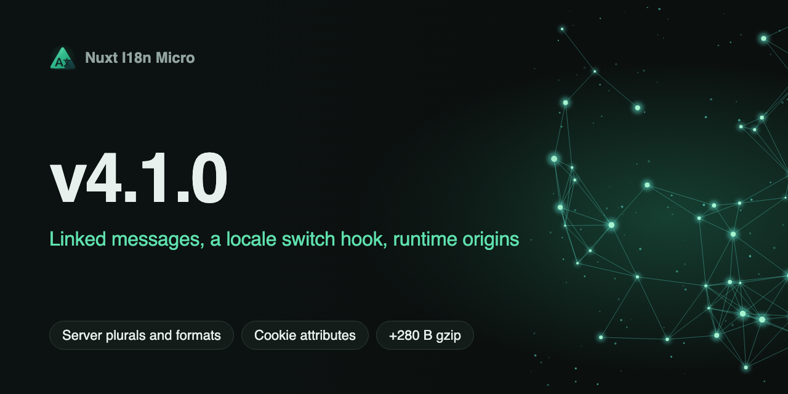

# Nuxt I18n Micro v4.1.0 — Linked Messages, a Locale Switch Hook, Runtime Origins

**Date**: 2026-11-04

**Version**: `v4.1.0`



**v4.1.0** adds what apps could not do before, without a second way to do what already works. Every option is opt-in: with your current config the output is the same as on 4.0, and the default bundle grows by about 280 B gzip (95 B with `hooks: false`).

## What's New?

### Linked Messages

A message can reuse another one, with the vue-i18n syntax. Turn it on with [`linkedMessages: true`](/api/module-options#linkedmessages):

```json [locales/en.json]
{
  "brand": "Acme",
  "title": "Welcome to @:brand",
  "shout": "@.upper:brand",
  "intro": "@.capitalize:{'nav.home'}."
}
```

Links are resolved when the dictionary is built, in every mode (premerged, `mode: 'source'`, dev and HMR), across the root file, the page file and the fallback chain. `$t` does no extra work and the browser bundle does not change. `{name}` params inside a linked text stay and fill in at runtime; case modifiers leave them alone. A cycle or a missing key stays as written, with one build warning. [Translations](/guide/translations#linked-messages) has the details.

### `i18n:beforeLocaleSwitch`

A runtime hook that runs before the page moves to another locale. It can stop the switch or send it to another locale:

```ts [plugins/locale-guard.ts]
export default defineNuxtPlugin((nuxtApp) => {
  nuxtApp.hook('i18n:beforeLocaleSwitch', (ctx) => {
    if (ctx.to === 'de' && !hasGermanContract()) ctx.cancel = true
  })
})
```

It fires once per switch: for a link or `$switchLocale` under the prefix strategies, and before the dictionary changes under `no_prefix` and in hash mode. `$switchLocale` resolves `false` when a subscriber cancels. To act after a switch, watch the locale: `watch(() => $getLocale(), …)` fires once the new dictionary is in place. See [Hooks](/api/events).

### Plurals and Formats on the Server

The `t` of `useTranslationServerMiddleware` keeps its signature and gains the helpers the page has:

```ts [server/api/order.ts]
export default defineEventHandler(async (event) => {
  const t = await useTranslationServerMiddleware(event)
  return {
    items: t.tc('apples', 5),
    total: t.tn(1234.5, 'currency'),
    date: t.td(new Date(), 'short'),
  }
})
```

`tc`, `tn`, `td`, `tdr` and `has` follow the same rules as `$tc`, `$tn`, `$td`, `$tdr` and `$has`, with your `plural` function and formats. See [Server-side translations](/guide/server-side-translations).

### Locale Cookie Attributes

[`localeCookieOptions`](/api/module-options#localecookieoptions) sets `domain`, `path`, `secure`, `sameSite` and `maxAge` of the locale cookie, for example to share the choice across subdomains or to work inside an iframe:

```ts
export default defineNuxtConfig({
  i18n: {
    localeCookie: 'user-locale',
    localeCookieOptions: { domain: '.example.com', sameSite: 'none', secure: true },
  },
})
```

The attributes come from the config only. The build warns about `sameSite: 'none'` without `secure`, which browsers drop.

### Runtime Origins

One build can run on staging and production with different origins:

```bash
NUXT_I18N_META_BASE_URL=https://staging.example.com \
NUXT_I18N_LOCALE_BASE_URLS=en=https://staging.example.com,de=https://staging.example.de \
node .output/server/index.mjs
```

`NUXT_I18N_META_BASE_URL` sets the origin of canonical and hreflang. `NUXT_I18N_LOCALE_BASE_URLS` moves the domains of a build that has locale domains; a build without them warns and ignores it. `nuxt generate` per host stays a build-time choice. See [Runtime overrides](/guide/runtime-overrides).

### Translations from Other Nuxt Modules

`additionalTranslationDirs` accepts absolute paths, so a Nuxt module can ship its own keys:

```ts [my-module/module.ts]
export default defineNuxtModule({
  setup(_, nuxt) {
    const { resolve } = createResolver(import.meta.url)
    nuxt.options.i18n.additionalTranslationDirs ??= []
    nuxt.options.i18n.additionalTranslationDirs.push(resolve('./locales'))
  },
})
```

The list is read after every module has run, so the order in `modules` does not matter. The build, the dev watcher, DevTools, the types generator and the CLI all read it.

### Smaller Additions

- [`redirectStatusCode`](/api/module-options#redirectstatuscode) sets the code of the module's locale redirects: 301, 302, 303, 307 or 308 (default 302). A permanent code on a preference redirect is cached by browsers: use it only when the redirect never depends on the visitor.
- `$defineI18nRoute(false)` takes a page out of localization, like `globalLocaleRoutes: { page: false }`. It used to be ignored.
- `t()` and `interpolate` take a list for `{0}`, `{1}`: `$t('pair', ['a', 'b'])`. The new `TranslateParams` type in `@i18n-micro/types` names what they take; `Params` and custom `plural` functions are unchanged.

### API Reference

The [API pages](/api/packages) are generated from the sources' JSDoc: each export with its description, signature, params and members, grouped by kind, without the inherited DOM attributes and without repeating types that live in another package. [Module options](/api/module-options) has one section per option.

## Upgrading

No change is needed. Update `nuxt-i18n-micro` and the `@i18n-micro/*` packages you use together.
