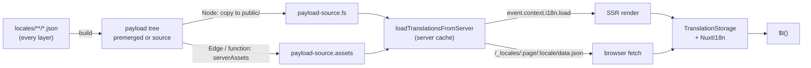

# Architecture

This page follows a translation from the JSON file in `locales/` to `$t()` on screen, and names the file behind each step. Read it before you change the build, the server loader, the payload route or the client storage. App authors do not need it: the supported knobs are listed under [Public surface](#public-surface), and the [Guide](/guide/translations) explains them.

## Overview

## Build

| Step | Source |
| --- | --- |
| Layers are read in order (extended layers first, the project last); `additionalTranslationDirs` before `translationDir` | `src/module.ts` (`rootDirs`) |
| `premerged` (default): root + page + fallback chain merged into one `{page}/{locale}/data.json` per page and locale, in `.nuxt/i18n-merged` | `src/build/build.ts` (`preMergeLocales`) |
| `source`: a compact copy of the source files in `.nuxt/i18n-source`, merged per request at runtime | `src/build/build.ts` (`buildTranslationSourceLayers`), `@i18n-micro/utils/merge-source` |
| Fallback chain: global `fallbackLocale`, then each locale's `fallbackLocale` link, then the locale | `@i18n-micro/utils/merge-source` (`buildFallbackLocaleChain`) |
| `dateBuild`: a hash of the translation files unless set | `src/module.ts` (`resolveDateBuild`), `src/build/payload-stats.ts` |
| Templates: `#build/i18n.strategy.mjs` (public config + `createI18nStrategy`), `i18n.config.mjs` (private config, Nitro alias `#i18n-internal/config`), `i18n.plural.mjs` | `src/module.ts` (`registerI18nTemplates`), `src/plural-template.ts` |

Where the tree goes depends on the Nitro preset, decided in `nitro:init`. A preset that serves `public/` from disk (`node-server`) gets the tree copied to `public/<apiBaseUrl>/` and reads it with `readFile` (`src/runtime/server/payload-source.fs.ts`). Edge, function and `serveStatic: "inline"` presets embed it as Nitro `serverAssets` under `assets:i18n` (`payload-source.assets.ts`). Both readers reject paths that leave the payload root.

## Server

- **Middleware** `src/runtime/server/middleware/i18n.global.ts` runs on every request except internals (`/api`, `/_nuxt`, `/__*`, the payload route, static files). It detects the request locale once (`detectRequestLocale` in `server/utils/locale-detector.ts`) and stores `event.context.i18n = { locale, translations, load, config }`. `translations` is the `index` chunk when `serverTranslationPreload` is on.
- **Loader** `server/utils/server-loader.ts` (`loadTranslationsFromServer(locale, page)`): in dev it reads the live files on every call; with `apiBaseServerHost` it fetches the payload from that host; otherwise it reads through `#i18n-internal/payload-source` (one file in `premerged`, a runtime merge in `source`). A premerged page without its own folder shares the root entry, so made-up page names cannot add entries.
- **Server cache** `server/utils/server-translation-cache.ts`: one LRU `CacheControl` per process on `globalThis[Symbol.for('__NUXT_I18N_SERVER_CACHE_CC__')]`, at most `cacheMaxSize` entries (1000 when unset), `cacheTtl` from write. Entries hold the data and its pre-serialized JSON; concurrent loads of one key share one read. It is emptied only by a restart.
- **Route** `server/routes/i18n.ts` serves `/{apiBaseUrl}/:page/:locale/data.json` from the loader's pre-serialized JSON, 404 for a disabled or unknown locale. Outside dev it sets `public, max-age=<httpCacheDuration>, immutable` only when the request's `?v=` equals `dateBuild`; otherwise `public, max-age=0, must-revalidate`.

## Client and SSR runtime

- **Loader plugin** `src/runtime/plugins/01.plugin.ts` resolves the initial locale, configures storage, loads the first chunk and registers the helpers. During SSR the chunk comes from `event.context.i18n.load` (no HTTP); dictionaries are never written into the HTML payload. The server adds a `<link rel="preload" as="fetch">` for the chunk the browser will fetch while hydrating.
- **`TranslationStorage`** `src/runtime/utils/storage.ts`: a module-level instance whose `CacheControl` lives on `globalThis[Symbol.for('__NUXT_I18N_STORAGE_CC__')]`, keyed `locale:routeName`. Chunks are frozen shallow copies. Bounded by `cacheMaxSize` (1000 on the server when unset, unbounded in the browser), expired by `cacheTtl`.
- **`NuxtI18n`** `src/runtime/utils/nuxt-i18n.ts` (extends `BaseI18n` from `@i18n-micro/core`): one per app. It holds the chunk map (`storage.translations`, FIFO-evicted with `cacheMaxSize`), the active dictionary, and the outgoing dictionary.
- **Navigation** does not merge. `applySwitchContext` installs the new chunk as the active dictionary; on a same-locale navigation the old one stays as a fallback layer so the leaving page still renders its keys. `finishTransition` drops it on `page:finish`, or when NuxtPage's `~transitionPromise` resolves.
- **Patches merge**: `$mergeTranslations`, `$loadPageTranslations` and `i18n:register` deep-merge into the stored chunk and, when it is active, into the dictionary. Stored trees are never edited in place.
- **`NuxtTranslationLoader`** dedupes in-flight loads per key and keeps a switch generation, so a slow load cannot overwrite a newer navigation. `reload()` (`$clearCache`, dev HMR) clears both caches and re-applies the current chunk without blanking the screen.
- **Dev HMR**: a Vite plugin in `src/module.ts` swallows updates of translation files and sends `i18n-micro:update`; the client plugin from `src/hmr-plugin.ts` calls `$clearCache()`. The dev server reads live files, so nothing on the server needs invalidating.

## Public surface

Everything above is internal and may change in any release. Apps may rely on:

| Need | Use |
| --- | --- |
| Reload translations in the browser | [`$clearCache()`](/api/methods#clearcache) |
| Add or patch translations at runtime | [`$mergeTranslations`](/api/methods#mergetranslations), [`$loadPageTranslations`](/api/methods#loadpagetranslations), [`i18n:register`](/api/events) |
| Bound or expire the caches | [`cacheMaxSize`](/api/module-options#cachemaxsize), [`cacheTtl`](/api/module-options#cachettl) |
| HTTP caching of payloads | [`httpCacheDuration`](/api/module-options#httpcacheduration), [`dateBuild`](/api/module-options#datebuild) |
| Where payloads are written | [`translationPayloads`](/api/module-options#translationpayloads), [Deployment](/guide/deployment) |
| Translations in a Nitro handler | [Server routes](/guide/server-side-translations) |

## Related

- [Contributing](/contributing/)
- [Testing the module](/contributing/testing)
- [Translation files](/guide/translations)
- [Performance](/guide/performance)
