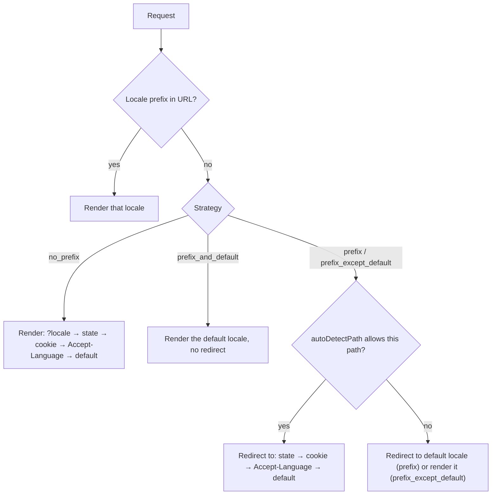

# Locale detection

Every request gets one locale, picked from the same list of sources in the same order on the server and in the browser. Read this when you decide how first-time visitors land on a language, whether their choice is remembered, and what your server API sees. You get the precedence, the redirect each strategy makes, and the options that turn each source on or off.

::: tip Prerequisites
[Routing strategies](/guide/strategy)
:::

## The precedence

The first source that names an **enabled** locale wins. An invalid or malformed value (an unknown code, a broken cookie) is skipped and the next source counts.

| # | Source | Counts when |
| --- | --- | --- |
| 1 | URL prefix (`/de/about`) | prefix strategies. Under `prefix_except_default` and `prefix_and_default` an unprefixed URL is the default locale |
| 2 | `?locale=de` | pages: `no_prefix` only. Server API helpers: always, and before the URL |
| 3 | Locale state set by the app (`useI18nLocale().setLocale()`) | the URL has no locale |
| 4 | Cookie | [`localeCookie`](/api/module-options#localecookie) is set (`'user-locale'` automatically under `no_prefix`) |
| 5 | `Accept-Language` header | [`autoDetectLanguage`](/api/module-options#autodetectlanguage) is `true` (default) |
| 6 | [`defaultLocale`](/api/module-options#defaultlocale) | always |

So under a prefix strategy the URL decides what a page shows; the preference sources (3–5) only decide where a visitor is **redirected**, and only on the paths `autoDetectPath` allows. Under `no_prefix` there is nothing to redirect, and the preference sources decide what the page shows.



## Redirects per strategy

Redirects are a `302`, made on the server before the page renders, and by a route middleware for client navigations. Query and hash are kept. With [`redirects: false`](/api/module-options#redirects) none happen; wrong prefixes are still a 404.

Visitor prefers `de` (cookie or header), `defaultLocale: 'en'`, default `autoDetectPath: '/'`:

| Request | `prefix_except_default` | `prefix` | `prefix_and_default` | `no_prefix` |
| --- | --- | --- | --- | --- |
| `/` | → `/de` | → `/de` | `/` in `en` | `/` in `de` |
| `/about` | `/about` in `en` | → `/en/about` | `/about` in `en` | `/about` in `de` |
| `/fr/about` | `/fr/about` | `/fr/about` | `/fr/about` | — |
| `/en/about` | 404 | `/en/about` | `/en/about` | — |

`prefix_and_default` never redirects: an unprefixed URL belongs to the default locale, and other locales live under their prefix. A visitor who prefers `en` is not redirected from `/` under `prefix_except_default`. Targets have no trailing slash (`/de`, not `/de/`) and follow custom paths (`/about` → `/de/ueber-uns`).

### `autoDetectPath`

Where the preference sources may move a visitor:

| Value | Preference counts on |
| --- | --- |
| `'/'` (default) | `/` only. Deep links stay in the language of the URL |
| `'no_prefix'` | every path without a locale prefix (`/about` → `/de/about`) |
| `'/welcome'` | that exact path (a trailing slash is ignored) |
| `'*'` | every path, prefixed ones too: `/about` and `/fr/about` → `/de/about` when the visitor prefers `de` |

On paths it does not allow, an unprefixed URL is treated as the default locale, so `prefix` still sends `/about` to `/en/about`. With `'*'` the server ignores the app's state, and a prefixed URL no longer records its own locale in the cookie; the cookie changes when the visitor switches with `$switchLocale`. Shared links then open in the reader's language, which can surprise; prefer `'/'` or `'no_prefix'` unless that is what you want.

## Accept-Language

The header is read as RFC 9110 defines it and matched against the locale **codes** in your config:

- Entries are tried by `q` value, highest first (`fr;q=0.1, de;q=0.9` → `de`). `q=0` means "not this language"; an entry with a malformed `q` is ignored. `*` matches nothing.
- `_` is read as `-` (`en_US` = `en-US`).
- Per entry: the exact code, then shorter forms (`de-AT` → `de`), then a regional locale of the same language (`en` → `en-US`). This does not depend on the order of `locales`.
- Scripts are never crossed: `zh-TW` and `zh-HK` imply Traditional, `zh-CN` Simplified, so `zh-CN` never matches a `zh-Hant` locale.
- Disabled locales never match.

```ts
// locales: [{ code: 'en' }, { code: 'de' }, { code: 'zh-Hant' }]
// 'de-CH,de;q=0.9,en;q=0.8'  → 'de'
// 'en-GB'                    → 'en'
// 'zh-TW'                    → 'zh-Hant'
// 'zh-CN'                    → no match, next source
```

Turn header detection off with `autoDetectLanguage: false`; the cookie and the state still count.

## The cookie

- **Off by default** for the prefix strategies (`localeCookie: null`). Redirects then work from the header alone, and the choice is not remembered across visits. Set `localeCookie: 'user-locale'` to remember it.
- Under `no_prefix` it is `'user-locale'` unless you set another name. `localeCookie: null` turns it off there too.
- It is written when the visitor switches (`$switchLocale`, `<i18n-switcher>`, `useI18nLocale().setLocale()`), and on a server render of a prefixed URL (`/fr/about` stores `fr`).
- It lasts one year (`path=/`, `SameSite=Lax`).
- Under `hashMode` the preference lives in the `hash-locale` cookie instead; server and client read the same one. The server renders that locale and never redirects; a locale in the hash (`/#/de`) wins over it and applies right after hydration.

Read and set the preference with [`useI18nLocale`](/composables/useI18nLocale), not with `useCookie` or `useState` directly.

## Your own detection

To pick the locale yourself (a user setting, a subdomain), call `useI18nLocale().setLocale(code)` in a plugin that runs before the module's plugin. It becomes source 3, the app's state. [Custom locale detection](/guide/custom-auto-detect) has the full recipe, including turning the built-in detection off.

## Server API routes

[`useLocaleServerMiddleware`](/guide/server-side-translations) and `useTranslationServerMiddleware` use their own order, because an API URL is rarely localized:

1. `?locale=`
2. a `[locale]` route param, or a locale prefix in the path
3. cookie (when `localeCookie` is set)
4. `Accept-Language` (when `autoDetectLanguage` is on)
5. `defaultLocale`

`localeCookie: null` and `autoDetectLanguage: false` switch sources 3 and 4 off here too.

## Runtime overrides

[Runtime overrides](/guide/runtime-overrides) change the list the sources are matched against:

- Runtime `disabledLocales` are removed from every step: a cookie or header naming one is skipped.
- A runtime `defaultLocale` is step 6 under `prefix` and `no_prefix`.
- Under `prefix_except_default` and `prefix_and_default` the default locale is fixed at build (its pages are the unprefixed routes). A runtime `defaultLocale`, or disabling the build default, is ignored with a warning.

## Related

- Next: [Page config](/guide/per-component-translations): per-page locales and translations
- [Custom locale detection](/guide/custom-auto-detect)
- [Server routes and API](/guide/server-side-translations)
- [`useI18nLocale`](/composables/useI18nLocale)
