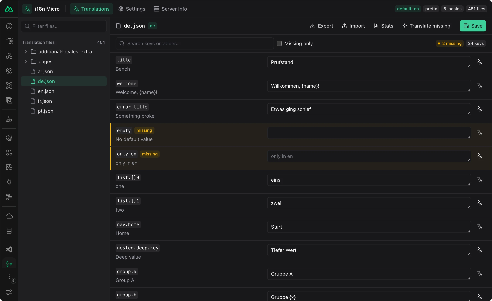
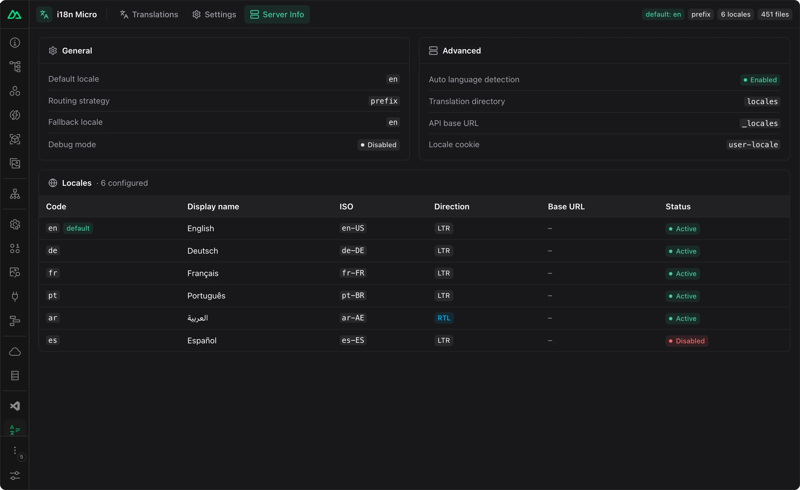
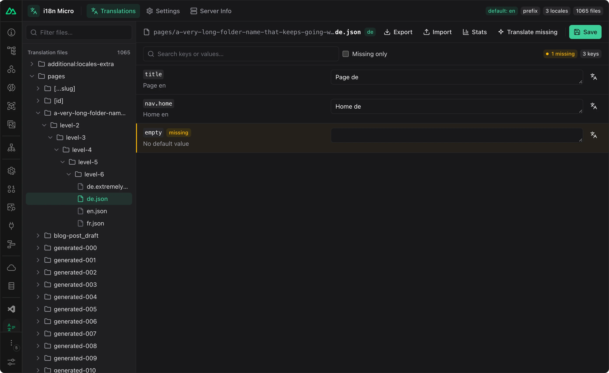
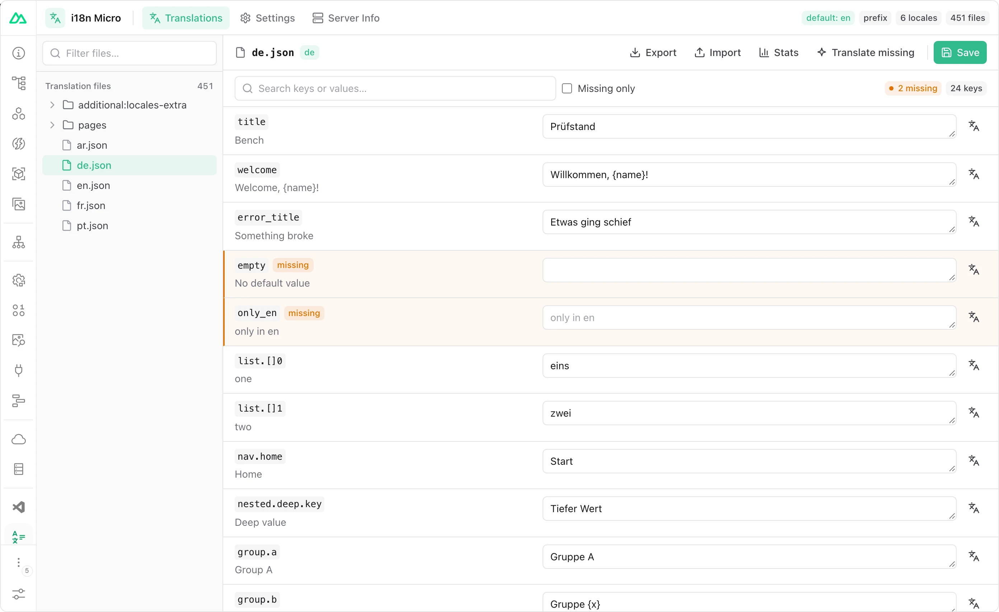

# DevTools

In `nuxt dev` the module adds two debugging aids: an **i18n Micro** tab in Nuxt DevTools for browsing and editing translation files, and a Vue DevTools inspector for the live locale and loaded dictionaries. Both exist only in development and add nothing to production builds. The Nuxt tab needs only Nuxt DevTools enabled; the Vue inspector also needs the Vue DevTools browser extension.

## Nuxt DevTools tab

```ts
// nuxt.config.ts
export default defineNuxtConfig({
  modules: ['nuxt-i18n-micro'],
  devtools: { enabled: true }, // the tab is registered only when DevTools are on
})
```

Open Nuxt DevTools (`Shift + Alt + D`) and pick **i18n Micro**. The tab shows:

- every JSON file under `locales/` (root and `pages/`) of every layer, plus root files from `additionalTranslationDirs`;
- an editor per file; **Save** writes the file back to disk, and the dev server reloads the translations;
- **Export** / **Import** of a file as JSON, and **Stats** with key counts and translation coverage;
- a config view of the resolved module options;
- **Translate**, which fills missing keys with a machine-translation engine you configure in the tab's settings.

Saving writes only existing `.json` files inside your translation directories. When a file exists in several layers, the project's copy is written.

<tabs>
<tabs-item label="Editor">



</tabs-item>

<tabs-item label="Missing only">


</tabs-item>

<tabs-item label="Stats">


</tabs-item>

<tabs-item label="Translate">


</tabs-item>

<tabs-item label="Settings">


</tabs-item>

<tabs-item label="Server info">



</tabs-item>

<tabs-item label="Large projects">



</tabs-item>

<tabs-item label="Light theme">



</tabs-item>
</tabs>

## Vue DevTools inspector

With the Vue DevTools browser extension, the module registers an i18n inspector (current locale, route chunk, loaded keys) and a timeline with locale switches, chunk loads and missing keys.

```ts
// nuxt.config.ts
export default defineNuxtConfig({
  modules: ['nuxt-i18n-micro'],
  i18n: {
    debug: true, // also log every $t / $ts / $tc call on the timeline
    // vueDevtools: false, // turn the inspector off, keep the Nuxt tab
  },
})
```

[`vueDevtools`](/api/module-options) defaults to `true`. `debug: true` is verbose; keep it for short sessions.

## Outside Nuxt

The same UI is published as [`@i18n-micro/devtools-ui`](/integrations/devtools-ui-package) for Vite apps built on the framework packages; see that page for the setup.

## Related

<card-group>
<card icon="i-lucide-book-open" title="Translation files" to="/guide/translations">


</card>

<card icon="i-lucide-boxes" title="DevTools UI package" to="/integrations/devtools-ui-package">


</card>

<card icon="i-lucide-book-open" title="CLI" to="/guide/cli">


</card>
</card-group>
