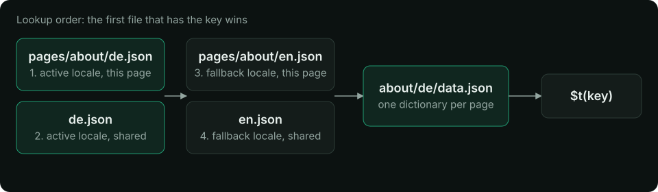

# Translation files

Translations are plain JSON files: one root file per locale for shared keys, and one file per page and locale for that page's keys. Read this when you add pages, share keys between them or set up fallbacks. You learn which file a key must go in, what a page can see, and when each file is loaded.

## Layout

```text
locales/
├── en.json                 # root: menus, footer, buttons
├── de.json
└── pages/
    ├── index/              # pages/index.vue
    │   ├── en.json
    │   └── de.json
    ├── about/              # pages/about.vue
    │   ├── en.json
    │   └── de.json
    └── products-id/        # pages/products/[id].vue
        ├── en.json
        └── de.json
```

- The folder under `locales/pages/` is the Nuxt **route name** of the page: `pages/products/[id].vue` is `products-id`, `pages/blog/[slug]/comments.vue` is `blog-slug-comments`.
- Keys can nest to any depth; `$t('auth.form.login')` reads `{ "auth": { "form": { "login": … } } }`.
- `translationDir` moves the folder (`'locales'` by default, relative to the project root, also under the Nuxt 4 `app/` layout).
- Missing files are created as `{}` when Nuxt resolves the pages, unless [`disableWatcher`](/api/module-options#disablewatcher) is set.

## What a page sees



A page's dictionary is its root file merged with its page file, deeply (every level). The page file wins on a clash:

```json
// locales/en.json
{ "title": "My shop", "nav": { "home": "Home", "cart": "Cart" } }
```

```json
// locales/pages/about/en.json
{ "title": "About us", "nav": { "cart": "Basket" } }
```

```ts
// on /about
t('title') // 'About us'
t('nav.home') // 'Home'   (root)
t('nav.cart') // 'Basket' (page wins)
// on any other page
t('title') // 'My shop'
```

A page without its own folder gets the root dictionary alone. Keys of other pages are not visible.

### Fallback locales

A key missing in the active locale is taken from its fallback locale before the key itself is shown:

```ts
// nuxt.config.ts
export default defineNuxtConfig({
  modules: ['nuxt-i18n-micro'],
  i18n: {
    locales: [
      { code: 'en', iso: 'en-US' },
      { code: 'de', iso: 'de-DE' },
      { code: 'de-at', iso: 'de-AT', fallbackLocale: 'de' },
    ],
    defaultLocale: 'en',
    fallbackLocale: 'en', // global, for every locale
  },
})
```

- A locale's own `fallbackLocale` is followed to its end: `de-at` → `de` → `en`.
- The global `fallbackLocale` is the weakest layer, under every chain.
- Each locale in the chain adds its root file, then its page file, from the weakest fallback up to the active locale. So the active locale's root file beats a fallback locale's page file.

Without a fallback, a missing key renders as the key (`'nav.home'`) and logs a warning in the browser console in dev ([`missingWarn`](/api/module-options#missingwarn)).

### Parameters

`{name}` takes `params.name`; `{0}`, `{1}` take the items of an array:

```json [locales/en.json]
{ "welcome": "Welcome, {name}!", "pair": "{0} and {1}" }
```

`$t('welcome', { name: 'Ada' })` reads `Welcome, Ada!` and `$t('pair', ['Ann', 'Bob'])` reads `Ann and Bob`. A placeholder with no param stays as written.

### Linked messages

With [`linkedMessages: true`](/api/module-options#linkedmessages) a message can reuse another one, with the vue-i18n syntax:

```json [locales/en.json]
{
  "brand": "Acme",
  "title": "Welcome to @:brand",
  "shout": "@.upper:brand",
  "intro": "@.capitalize:{'nav.home'}.",
  "greet": "Hi @:withName",
  "withName": "{name}!",
  "nav": { "home": "home" }
}
```

`title` reads `Welcome to Acme`, `shout` reads `ACME`, `intro` reads `Home.` and `$t('greet', { name: 'Ada' })` reads `Hi Ada!`.

- `@:key` inserts the text of `key`; `@.upper:`, `@.lower:` and `@.capitalize:` change its case, by the locale's `iso` (so `@.upper:` of `i` is `İ` in Turkish).
- A bare key runs to a space or one of `{ } @ % | ( )`, dots and other punctuation included: `@:nav.home`. A key followed by `.`, `,` or `!` goes in a literal: `@:{'nav.home'}.`.
- Links are resolved when the dictionaries are built (and when a server merges them in `mode: 'source'` or in dev), in the page's whole dictionary: its root keys, its fallback locales. `$t` reads plain text, so this costs nothing at runtime. `{name}` params in a linked text stay, and `$t` interpolates them.
- A link to a missing key, to an object, or in a cycle leaves the whole message as written, and the build warns once. So does an unknown modifier. Dynamic keys (`@:{name}`) and the old `@:(key)` form are not links.
- Messages added at runtime (`$mergeTranslations`, `$setTranslation`, the `i18n:register` hook, inline `$defineI18nRoute` locales) are not resolved.
- It is off by default: `@:` may already be plain text in your messages.

## Sharing and other sources

<table>
<thead>
  <tr>
    <th>
      Need
    </th>
    
    <th>
      Option
    </th>
  </tr>
</thead>

<tbody>
  <tr>
    <td>
      Only root files, no <code>
        pages/
      </code>
      
       folders
    </td>
    
    <td>
      <a href="/api/module-options#disablepagelocales">
        <code>
          disablePageLocales: true
        </code>
      </a>
    </td>
  </tr>
  
  <tr>
    <td>
      Two pages read one page folder
    </td>
    
    <td>
      <a href="/api/module-options#routeslocalelinks">
        <code>
          routesLocaleLinks
        </code>
      </a>
      
      : <code>
        { 'about-us': 'about' }
      </code>
    </td>
  </tr>
  
  <tr>
    <td>
      Shared root files in another folder
    </td>
    
    <td>
      <a href="/api/module-options#additionaltranslationdirs">
        <code>
          additionalTranslationDirs
        </code>
      </a>
      
      : <code>
        ['common']
      </code>
      
       (the main <code>
        translationDir
      </code>
      
       wins)
    </td>
  </tr>
  
  <tr>
    <td>
      Keys shipped by a Nuxt module
    </td>
    
    <td>
      the module adds its absolute folder to <code>
        additionalTranslationDirs
      </code>
      
      , see <a href="/api/module-options#additionaltranslationdirs">
        for module authors
      </a>
    </td>
  </tr>
  
  <tr>
    <td>
      Keys from a Nuxt layer
    </td>
    
    <td>
      Layers' files merge, the project's own files win. See <a href="/guide/layers">
        Layers
      </a>
    </td>
  </tr>
  
  <tr>
    <td>
      Keys added at runtime
    </td>
    
    <td>
      the <a href="/api/events">
        <code>
          i18n:register
        </code>
      </a>
      
       hook, <code>
        $mergeTranslations
      </code>
      
      , <code>
        $setTranslation
      </code>
    </td>
  </tr>
  
  <tr>
    <td>
      Keys inline in a page component
    </td>
    
    <td>
      <code>
        $defineI18nRoute({ locales: { en: { … } } })
      </code>
      
      , see <a href="/guide/per-component-translations">
        Page config
      </a>
    </td>
  </tr>
</tbody>
</table>

## How a page loads its dictionary


The module builds one payload per page and locale: `/{apiBaseUrl}/{page}/{locale}/data.json` (`/_locales/about/de/data.json` by default).

1. **Server render.** Nitro detects the locale and the page loads its payload from the server loader directly, with no HTTP request. The dictionary is not written into the HTML payload, so pages stay small.
2. **Hydration.** The browser fetches the same payload. The server already emitted a `<link rel="preload">` for it, so the fetch starts with the HTML.
3. **Navigation.** The next page's payload replaces the dictionary. The leaving page's keys still resolve until it is gone (end of the page transition, or `page:finish`), so a fading-out page does not flash raw keys. A chunk that fails to load (network error, 4xx or 5xx, a body that is not an object) leaves the current dictionary in place, and the next navigation loads it again. A failed locale switch is the same: `$switchLocale` resolves `false`, and calling it again, or clicking the switcher again, retries. Under the prefix strategies the URL has already moved by then, so `lang` and `$getLocale()` name the URL's locale while the old texts stay on screen.
4. **Cache.** Loaded payloads are cached on the server and in the browser; [Performance](/guide/performance) has the size and TTL knobs.

`translationPayloads.mode` decides how payloads are built. `'premerged'` (default) writes every page × locale file at build time. `'source'` keeps the source files and merges per request, which is smaller for large catalogs on Edge targets. Both give the same dictionaries. Where the files end up for each deploy target is on [Deployment](/guide/deployment).

## Editing in development

`nuxt dev` reads the files live. Saving a translation file refreshes the open page's dictionary in place: no reload, removed keys disappear, and a change to a root file reaches every page. A broken JSON file logs a warning with its path and is treated as empty. Set [`hmr: false`](/api/module-options#hmr) to refresh by hand instead.

## Related

<card-group>
<card icon="i-lucide-book-open" title="Page config" to="/guide/per-component-translations">

Per-page locales and inline translations

</card>

<card icon="i-lucide-braces" title="Methods" to="/api/methods">

`$t`, `$tc`, `$tn`, `$td`

</card>

<card icon="i-lucide-book-open" title="Deployment" to="/guide/deployment">


</card>
</card-group>
